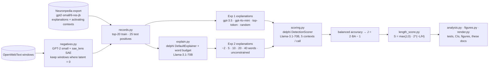

# Accurate and simple mechanistic-interpretability explanations

<!-- Generated from templates/README.md by `uv run python run.py --phase analyze --sample main`.
     Every number below is filled from results/main/numbers.json; edit the template, not this file. -->

**Length-penalized detection scoring for sparse-autoencoder (SAE) feature explanations: a score that rewards explanations for being both accurate and short.**

Detection scoring ([Paulo et al. 2024](https://arxiv.org/abs/2410.13928)) is implemented in EleutherAI's [delphi](https://github.com/EleutherAI/delphi), and SAEBench's autointerp metric is built on it ([Karvonen et al. 2025](https://arxiv.org/abs/2503.09532)). It is the standard way to score SAE feature explanations. An LLM gets only the explanation and must say which of 5 text snippets the feature fires on. That score rewards accuracy only; Paulo et al. note that "current scoring methods do not account for interpretation length". This repo adds one factor:

```
S = max(J, 0) · 2^(−L / H)
J = 2·balanced_accuracy − 1      (0 = chance, 1 = perfect; Youden's J)
L = explanation length in tokens (tiktoken o200k_base)
H = half-life: the score halves every H tokens (pre-registered: 20)
```

In log space, `log S = log J − (ln 2 / H)·L`: a constant cost per token, the minimum-description-length trade-off between fit and description length. The data takes no model runs and no training:

- Explanations and activating contexts come from [Neuronpedia's public export](https://neuronpedia-datasets.s3.us-east-1.amazonaws.com/index.html) for GPT-2 small (`6-res-jb`, [Bloom 2024](https://www.lesswrong.com/posts/f9EgfLSurAiqRJySD/open-source-sparse-autoencoders-for-all-residual-stream)).
- Non-activating contexts are random OpenWebText windows on which the same SAE is verified to be 0.
- delphi's scorer and explainer run unmodified, with Llama-3.1-70B via OpenRouter, the scorer family of Paulo et al.

Everything was pre-registered in [PREREG.md](PREREG.md) before any results existed. **[Paper (PDF)](paper/paper.pdf)** · [Reports](reports/) · [Interactive explorer](https://burnycoder.github.io/accurate-and-simple-mechanistic-interpretability-explanations/) · [Methodology](docs/methodology.md) · [Scored data on Hugging Face](https://huggingface.co/datasets/BurnyCoder/length-penalized-autointerp-gpt2-small) ([collection](https://huggingface.co/collections/BurnyCoder/accurate-and-simple-interpretability-explanations-6ae2bbf0e413a206073deb4e))

## Highlights

24576 latents in the SAE; 200 sampled at random; 2002 explanations scored; 21220 LLM calls (US$6.78).

- ✅ **The base scorer is valid.**
  - Random explanations (another latent's explanation) score J = -0.022 [-0.038, -0.006], about chance.
  - Neuronpedia's gpt-4o-mini explanations score J = 0.499 [0.453, 0.547], and its gpt-3.5-turbo explanations 0.444.
- ✅ **Longer explanations are more accurate, with diminishing returns.**
  - When Llama-3.1-70B is asked for ~2 vs ~40 words, J goes from 0.464 to 0.577 (+0.113 [0.079, 0.147]).
  - The gain per word is larger from 2→10 words than from 10→40.
- ❌ **Primary hypothesis falsified: at the pre-registered H = 20 there is no interior optimum.**
  - Mean S *decreases* steadily with length: 0.430 (~2 words) > 0.395 > 0.374 > 0.278 > 0.123 (~40 words).
  - At H = 20, the accuracy gained per extra token is smaller than the length cost, so on average the shortest explanation wins.
  - In an exploratory (not pre-registered) sweep, ~10 words ties ~2 words at H = 40 and clearly beats both ends at H = 80: +0.041 [0.013, 0.069] over ~2 words.
- ✅ **The length factor works as a selection rule.**
  - Among 8 candidate explanations per latent, picking by S instead of plain detection J gives explanations 39% shorter (median 5.5 vs 9.0 tokens).
  - The held-out J loss is only 0.031 [0.018, 0.046]: about 0.613 vs 0.644.
  - Picking by S beats "pick the shortest" by 0.146 J. Selection and evaluation used disjoint halves of the test snippets.
- 🔎 **The laziest baseline is competitive.**
  - `the token "X"` (median 5 tokens) gets J = 0.430, close to gpt-3.5-turbo's 0.444.
  - Under S it scores 0.365, above gpt-3.5-turbo (0.341) and level with gpt-4o-mini (0.374).
- 🔁 **The conclusions survive re-scoring.**
  - Per-explanation rankings are stable under a new batch shuffle: Spearman J = 0.96, S = 0.96.
  - They are also stable under a different scorer (Llama-3.3-70B): J = 0.97, S = 0.97.
  - Measuring length in words or characters instead of tokens changes S rankings negligibly (Spearman ≥ 0.996).


## Results

### Every explanation source, under plain detection (J) and the length-penalized score (S)

| explanation source | role | n | mean BA | mean J [95% CI] | median tokens | mean S (H=20) [95% CI] |
|---|---|---:|---:|---:|---:|---:|
| random-explanation control | control | 200 | 0.489 | -0.022 [-0.038, -0.006] | 8 | 0.021 [0.015, 0.029] |
| top-token baseline | baseline | 200 | 0.715 | 0.430 [0.383, 0.476] | 5 | 0.365 [0.326, 0.403] |
| gpt-3.5-turbo (Neuronpedia) | existing | 200 | 0.722 | 0.444 [0.399, 0.490] | 8 | 0.341 [0.307, 0.377] |
| gpt-4o-mini (Neuronpedia) | existing | 200 | 0.750 | 0.499 [0.452, 0.546] | 8 | 0.374 [0.339, 0.408] |
| Llama-3.1-70B, ~2 words | Exp 2 | 200 | 0.732 | 0.464 [0.422, 0.506] | 2 | 0.430 [0.393, 0.467] |
| Llama-3.1-70B, ~5 words | Exp 2 | 200 | 0.747 | 0.493 [0.455, 0.530] | 6 | 0.395 [0.365, 0.425] |
| Llama-3.1-70B, ~10 words | Exp 2 | 200 | 0.774 | 0.548 [0.509, 0.588] | 11 | 0.374 [0.348, 0.400] |
| Llama-3.1-70B, ~20 words | Exp 2 | 200 | 0.776 | 0.552 [0.513, 0.590] | 20 | 0.278 [0.258, 0.297] |
| Llama-3.1-70B, ~40 words | Exp 2 | 200 | 0.789 | 0.577 [0.541, 0.613] | 45 | 0.123 [0.115, 0.131] |
| Llama-3.1-70B, delphi default prompt | Exp 2 | 200 | 0.781 | 0.563 [0.524, 0.601] | 30 | 0.204 [0.189, 0.220] |

BA = balanced accuracy; J = 2·BA − 1; 95% bootstrap CIs over latents. *existing* = Neuronpedia's explanations; *Exp 2* = generated by Llama-3.1-70B with delphi's explainer prompt, asked for ~B words.


### H3 (primary): is there an intermediate length that beats both extremes at H = 20?

| comparison (S at H=20) | mean difference [95% CI] | Wilcoxon p (one-sided) | Holm p |
|---|---:|---:|---:|
| ~5 words − ~2 words | -0.035 [-0.064, -0.006] | 0.99 | 1 |
| ~5 words − ~40 words | +0.272 [+0.246, +0.297] | 6.6e-33 | 3.3e-32 |
| ~10 words − ~2 words | -0.056 [-0.081, -0.031] | 1 | 1 |
| ~10 words − ~40 words | +0.251 [+0.230, +0.271] | 1.9e-33 | 1.1e-32 |
| ~20 words − ~2 words | -0.152 [-0.181, -0.123] | 1 | 1 |
| ~20 words − ~40 words | +0.155 [+0.141, +0.169] | 6.8e-33 | 3.3e-32 |

No. The ~2-word explanations have the highest mean S, and every longer budget is significantly lower. H3 is **falsified** for H = 20.

### Where the optimum sits depends on H (exploratory)

| H (tokens) | random-explanation control | top-token baseline | gpt-3.5-turbo (Neuronpedia) | gpt-4o-mini (Neuronpedia) | Llama-3.1-70B, ~2 words | Llama-3.1-70B, ~5 words | Llama-3.1-70B, ~10 words | Llama-3.1-70B, ~20 words | Llama-3.1-70B, ~40 words | Llama-3.1-70B, delphi default prompt | best budget |
|---|---:|---:|---:|---:|---:|---:|---:|---:|---:|---:|---|
| 5 | 0.009 | 0.216 | 0.161 | 0.163 | 0.332 | 0.203 | 0.119 | 0.037 | 0.001 | 0.014 | ~2 words |
| 10 | 0.016 | 0.306 | 0.262 | 0.280 | 0.394 | 0.316 | 0.255 | 0.140 | 0.027 | 0.079 | ~2 words |
| 20 | 0.021 | 0.365 | 0.341 | 0.374 | 0.430 | 0.395 | 0.374 | 0.278 | 0.123 | 0.204 | ~2 words |
| 40 | 0.025 | 0.398 | 0.391 | 0.434 | 0.449 | 0.442 | 0.454 | 0.392 | 0.266 | 0.337 | ~10 words |
| 80 | 0.027 | 0.416 | 0.419 | 0.468 | 0.459 | 0.467 | 0.500 | 0.467 | 0.392 | 0.435 | ~10 words |
| ∞ (no length factor: max(J, 0)) | 0.029 | 0.435 | 0.450 | 0.505 | 0.469 | 0.494 | 0.551 | 0.556 | 0.578 | 0.565 | ~40 words |


H is an exchange rate between accuracy and brevity, not a measured quantity. For these GPT-2 latents, H = 20 is strong enough that the shortest explanations win on average. At H = 40, ~10-word and ~2-word explanations tie (+0.005 [-0.022, +0.032]). Only around H = 80 do ~10-word explanations win, at the length where accuracy gains flatten out (see the Exp 2 curve above). These sweep comparisons are post hoc.

### H4: does selecting by S give short and accurate explanations?

| selection rule | held-out mean J [95% CI] | median tokens |
|---|---:|---:|
| pick highest J (plain detection) | 0.644 [0.605, 0.682] | 9.0 |
| pick highest S (this method) | 0.613 [0.574, 0.649] | 5.5 |
| pick shortest | 0.467 [0.425, 0.509] | 2.0 |


### Reliability

| re-scoring | latents | explanations | Spearman J | Spearman S |
|---|---:|---:|---:|---:|
| same scorer, new shuffle seed (43) | 50 | 502 | 0.961 | 0.957 |
| Llama-3.3-70B as scorer | 50 | 502 | 0.971 | 0.968 |


### In plain words

- Compared with **plain detection scoring**, the new score prefers explanations that are 39% shorter and gives up only 0.031 accuracy (J) when picking the best explanation per feature. That is the intended trade.
- Compared with the **"just pick the shortest" baseline**, it keeps much more accuracy (0.146 higher J). Brevity alone is not what it rewards.
- The **random-explanation control** scores about zero under both J and S (0.021), so being short cannot rescue an unrelated explanation.
- **Where it did not work as hoped:** at the pre-registered strength (H = 20) the score pushes, on average, all the way to ~2-word labels. If descriptive ~10-word explanations are wanted, a much weaker penalty (H ≈ 80) is needed.
- **Ablation:** setting H = ∞ removes the length factor and recovers plain detection scoring, under which the longest (~40-word) explanations are best on average.

## Method in brief

- **Subject model and SAE:** GPT-2 small, residual stream before block 6, Joseph Bloom's 24,576-latent SAE (`gpt2-small-res-jb`).
- **Latents:** 200 drawn at random (seed 0) from the 17226 (70.1%) that have both Neuronpedia LLM explanations and ≥ 45 activating contexts. delphi's two few-shot latents are excluded.
- **Contexts per latent:**
  - the 20 strongest activating contexts go to the explainer only;
  - 25 activating test contexts are stratified over 5 activation-quantile bins;
  - 25 negatives are random 17-token OpenWebText windows on which the latent's activation is exactly 0.
- **Checking the negatives:** we run GPT-2 small + the SAE through sae_lens. Our activations reproduce Neuronpedia's exported maxima with Pearson r = 0.988.
- **Scorer:** delphi `DetectionScorer`, 5 contexts per prompt, temperature 0, Llama-3.1-70B-Instruct (OpenRouter, pinned to DeepInfra).
- **Statistics:** paired bootstrap 95% CIs (10,000 resamples over latents), one-sided Wilcoxon signed-rank tests, Holm correction.
  - H4 selects on one half of the test contexts and evaluates on the other, to avoid the winner's curse.
  - Parse failures affected 0.035% of samples.

Details: [docs/methodology.md](docs/methodology.md), [PREREG.md](PREREG.md) (including two deviations made before any main results), [reports/](reports/).

## How it works



### What happens when you run it

1. **`download`** lists and downloads Neuronpedia's public export for `gpt2-small/6-res-jb` (73 gzipped JSONL batches, about 200 MB, into `data/raw/`). It then checks which latents are eligible and draws the pre-registered samples (main 200, pilot 10, reliability 50) into `data/processed/`.
2. **`negatives`** loads GPT-2 small and the exact same SAE through `sae_lens`. It first checks that it reproduces Neuronpedia's exported activations. It then streams 4,000 random OpenWebText windows and records, for every sampled latent, the windows on which it is exactly 0.
3. **`score`** has two parts:
   - **Exp 2:** Llama-3.1-70B writes explanations at each word budget, using delphi's explainer prompt and the 20 strongest contexts.
   - **Exp 1 + Exp 2:** delphi's `DetectionScorer` asks Llama-3.1-70B, 5 contexts at a time, which contexts match each explanation.

   Every prompt and response goes, untruncated, to `logs/<timestamp>_<phase>.log` and to the terminal. Every per-context prediction goes to `results/<sample>/scores.jsonl`. Re-running skips finished jobs.
4. **`reliability`** re-scores 50 latents with a new shuffle seed, and again with Llama-3.3-70B as the scorer.
5. **`analyze`** recomputes balanced accuracy with delphi's own metric code, then derives J, L and S. It runs the pre-registered tests and writes `results/main/numbers.json`, `figures/*.png` and `docs/data.json`, and renders this README, `reports/` and `paper/` from `templates/`.

## Install and run

You need Linux, or WSL2 on Windows (delphi depends on vLLM, which only installs on Linux), [uv](https://docs.astral.sh/uv/), an NVIDIA GPU for the `negatives` phase (GPT-2 small; 8 GB is plenty), and an [OpenRouter](https://openrouter.ai) API key.

```bash
git clone https://github.com/BurnyCoder/accurate-and-simple-mechanistic-interpretability-explanations
cd accurate-and-simple-mechanistic-interpretability-explanations
cp .env.example .env   # then put your OPENROUTER_API_KEY in .env
```

On WSL2 with the repo on the Windows drive (`/mnt/c/...`), keep the virtual environment on the Linux filesystem. Importing torch and vLLM over `/mnt/c` takes minutes:

```bash
export UV_PROJECT_ENVIRONMENT=$HOME/.venvs/concise-interp
```

```bash
uv sync
uv run pytest -q
uv run python run.py --phase download
uv run python run.py --phase negatives
uv run python run.py --phase score --sample pilot
uv run python run.py --phase score --sample main
uv run python run.py --phase reliability
uv run python run.py --phase analyze --sample main
```

`analyze` alone regenerates every table, figure and number in this README and the paper from the committed `results/` files, with no API calls. The processed data (`data/processed/`) and all results are committed, so the analysis reproduces without re-downloading or re-scoring.

## Repository layout

| Path | What it is |
|---|---|
| `run.py` | Entry point; runs the phases in order. |
| `src/concise_interp/length_score.py` | **The method:** J, L, the length factor, S. |
| `src/concise_interp/{data,negatives,records,baselines,experiment}.py` | Data, verified negatives, delphi records, baselines and controls, jobs. |
| `src/concise_interp/{clients,scoring,explain}.py` | delphi's OpenRouter client (with logging), DetectionScorer, DefaultExplainer with a word budget. |
| `src/concise_interp/{analysis,figures,render}.py` | Statistics, figures, docs rendered from results. |
| `tests/` | pytest suite. |
| `PREREG.md` | Pre-registration (committed before any results) and its deviations. |
| `templates/` | Sources of this README, `reports/` and `paper/`. Every number is a placeholder filled from `results/main/numbers.json`. |
| `results/` | All scored explanations with per-context predictions. `pilot_discarded_old_negatives/` is the discarded first pilot. |
| `figures/`, `reports/`, `paper/`, `docs/` | Figures, experiment reports, paper (Markdown + PDF), GitHub Pages explorer + methodology. |

## Technologies

- [delphi](https://github.com/EleutherAI/delphi), pinned to commit `4fea06e`: detection scorer, explainer, OpenRouter client, metrics.
- [sae_lens](https://github.com/jbloomAus/SAELens) and [TransformerLens](https://github.com/TransformerLensOrg/TransformerLens): GPT-2 small and the SAE.
- [OpenRouter](https://openrouter.ai): Llama-3.1-70B-Instruct, pinned to the DeepInfra provider, with Llama-3.3-70B as the alternative scorer.
- [tiktoken](https://github.com/openai/tiktoken) (`o200k_base`) for lengths.
- [Neuronpedia](https://www.neuronpedia.org) exports and [OpenWebText](https://huggingface.co/datasets/Skylion007/openwebtext) for data.
- pandas, SciPy, matplotlib for analysis; pytest for tests; uv for the environment.

