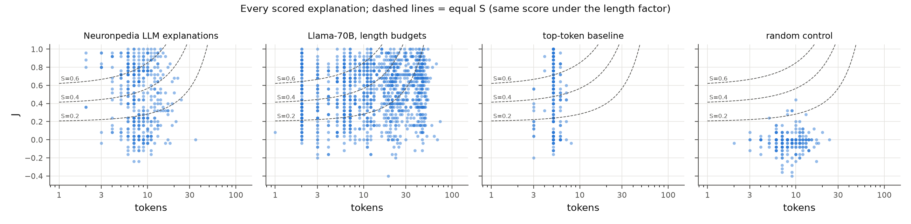

<!-- Generated from templates/paper/paper.md by `run.py --phase analyze --sample main`.
     Every number is filled from results/main/numbers.json. -->

# Abstract

Detection scoring ([Paulo et al. 2024](https://arxiv.org/abs/2410.13928)) is a widely used way to grade natural-language explanations of sparse autoencoder (SAE) latents, and SAEBench's autointerp metric is similar to it. It rewards accuracy only. We propose the smallest change that also rewards brevity, $S = \max(J, 0)\cdot 2^{-L/H}$: Youden's $J = 2\,\mathrm{BA} - 1$ from the detection scorer, times a factor that halves every $H$ tokens of explanation length $L$.

We test it with no training and minimal custom code:

- **Data:** Neuronpedia's public explanations and activations for 200 randomly sampled latents of a GPT-2 small residual SAE, plus random negatives verified with the same SAE.
- **Code:** delphi's unmodified detection scorer and explainer, with Llama-3.1-70B-Instruct.

We pre-registered four hypotheses. Results:

- The scorer is valid. Random explanations score $J$ = -0.022; real ones 0.444–0.499.
- Asking the same explainer for ~2 to ~40 words raises $J$ from 0.464 to 0.577, with diminishing returns.
- Our primary hypothesis, an interior optimum of $S$ at the pre-registered $H = 20$, is **falsified**. Mean $S$ decreases monotonically with length, so on average the shortest explanations win. In an exploratory, post-hoc sweep, ~10-word explanations only tie the shortest at $H = 40$; at $H = 80$ their mean is higher, but not significantly (one-sided Wilcoxon $p$ = 0.0505, uncorrected, for the budget picked as the best mean).
- Used to choose among 8 candidate explanations per latent, with cross-fitted held-out evaluation, $S$ selects explanations 39% shorter than plain detection scoring does, at a cost of 0.031 $J$ [0.018, 0.046]. That is 0.146 $J$ better than simply picking the shortest.

Under $S$, a top-token baseline (`the token "X"`) is not distinguishable from Neuronpedia's gpt-3.5-turbo or gpt-4o-mini explanations (post hoc; both paired 95% CIs include 0). Code, data, logs and pre-registration: <https://github.com/BurnyCoder/accurate-and-simple-mechanistic-interpretability-explanations>.

# 1. Introduction

Sparse autoencoders (SAEs) decompose a language model's activations into many sparse latents ("features"), and each latent is usually given a natural-language explanation written by an LLM. Explanations are judged by *auto-interpretability* scores. An LLM is given only the explanation and asked to predict where the latent fires. Two ways of doing this are simulating per-token activations ([Bills et al. 2023](https://openaipublic.blob.core.windows.net/neuron-explainer/paper/index.html)) and classifying whole contexts as activating or not, called detection ([Paulo et al. 2024](https://arxiv.org/abs/2410.13928)). SAEBench's autointerp metric is a detection-style score similar to it, with gpt-4o-mini as the judge ([Karvonen et al. 2025](https://arxiv.org/abs/2503.09532), §3.2.2), and detection is implemented in EleutherAI's open-source [delphi](https://github.com/EleutherAI/delphi) library. A recent study of autointerp pipelines found it to be the most stable of the four autointerp metrics it compared, on two subject models ([van der Ben et al. 2026](https://arxiv.org/abs/2607.19386)).

These scores reward accuracy only. Paulo et al. state that "current scoring methods do not account for interpretation length". An explanation that lists every pattern it noticed is not penalized for its length, even though a human reader, or a downstream circuit analysis, pays for every word. In other settings, GPT-4 as a judge prefers longer answers more than human raters do ([Saito et al. 2023](https://arxiv.org/abs/2310.10076)), and leaderboards have had to correct for length ([Dubois et al. 2024](https://arxiv.org/abs/2404.04475)).

We make the smallest change that puts brevity into the objective. We multiply the above-chance detection score by a factor that halves every H tokens:

$$S = \max(J, 0)\cdot 2^{-L/H},\qquad J = 2\,\mathrm{BA} - 1.$$

Here BA is delphi's balanced accuracy and L is the explanation's length in tokens. In log space, $\log S = \log J - (\ln 2/H)\,L$: a constant cost per token. This is analogous to, not an instance of, the two-part code of minimum description length ([Rissanen 1978](https://doi.org/10.1016/0005-1098(78)90005-5)): the length term prices the explanation, but $-\log J$ is a fit penalty, not the code length of the data given the explanation. Ayonrinde et al. ([2024](https://arxiv.org/abs/2410.11179)) apply MDL to the SAE's latent code and decoder; we apply the same fit-plus-length idea to the text explanation.

To keep custom work minimal, we use existing explanations and activation data from [Neuronpedia's](https://www.neuronpedia.org) public export for GPT-2 small, and delphi's scorer and explainer unchanged.

# 2. Background: detection scoring

For a latent and an explanation, the scorer LLM sees contexts in shuffled batches of 5 (Paulo et al., App. D.1). Some contexts contain the latent's activation and some do not. For each context it answers 1 or 0 ("does this context match the explanation?"). Paulo et al. use 100 activating contexts (10 per activation decile) and 100 random non-activating contexts (§4.2, App. D.4, D.6), with Llama-3.1-70B-Instruct as both explainer and scorer (§3.2, App. D.6; their App. F states 4-bit quantization for its experiments). Because non-activating contexts are included, the score reflects both recall (do activating contexts match?) and precision (do non-activating ones not match?) of the explanation (§3.3.1).

We use delphi's `DetectionScorer` with its default prompt and three few-shot examples. Two of those examples are latents of the very SAE we study (6048 and 9396), so we exclude them; the third comes from the layer-8 SAE.

# 3. Method

**Score.** delphi reports balanced accuracy $\mathrm{BA} = (\mathrm{TPR} + \mathrm{TNR})/2$, computed with its own `compute_confusion` and `compute_classification_metrics`. We use Youden's $J = 2\,\mathrm{BA} - 1 = \mathrm{TPR} - \mathrm{FPR}$ ([Youden 1950](https://doi.org/10.1002/1097-0142(1950)3:1%3C32::AID-CNCR2820030106%3E3.0.CO;2-3)), because chance is then 0. If the length factor multiplied BA instead, a short random explanation (BA ≈ 0.5) would beat a long accurate one. The clip $\max(J, 0)$ keeps below-chance explanations from gaining by being short.

L is the token count of the stripped explanation under tiktoken's `o200k_base` encoding. That tokenizer is fixed, so L does not depend on the scorer. Words and characters are checked as alternatives.

The half-life H is the exchange rate between accuracy and brevity. We pre-registered H = 20 tokens: a 10-token explanation keeps 71% of its J and a 40-token one keeps 25% (Neuronpedia's explanations have a median of 8 tokens). We report a sweep over H.

**Data.**

- **SAE and latents.** We use Joseph Bloom's residual-stream SAE for GPT-2 small ([Radford et al. 2019](https://cdn.openai.com/better-language-models/language_models_are_unsupervised_multitask_learners.pdf)) at layer 6 (`blocks.6.hook_resid_pre`, 24,576 latents with a ReLU encoder, sae_lens's `standard` architecture), as exported by Neuronpedia. A latent is eligible if it has explanations from both gpt-3.5-turbo and gpt-4o-mini, at least 45 activating 17-token contexts and at least 25 zero-activation rows in the export, and is not one of delphi's few-shot latents. Alone, these filters keep 99.9%, 82.6% and 86.9% of latents; together they leave 17226 of 24576 (70.1%). We sample 200 at random (seed 0).
- **Contexts per latent.**
  - The 20 strongest contexts are reserved for the explainer.
  - 25 test positives are drawn, 5 from each of 5 equal-count activation-quantile bins of the remaining contexts. These are quantiles of the export's rows, which hold only fairly strong activations: every test positive reaches at least 10% of its latent's top exported activation (bin medians, strongest to weakest: 0.78, 0.63, 0.47, 0.32, 0.16). Paulo et al. sample deciles of the full activation distribution, so our detection task is easier and absolute $J$ is not comparable with theirs.
  - 25 negatives are drawn from 4000 random OpenWebText windows on which the latent's activation is exactly 0.
- **Verifying the negatives.** We compute those activations with [sae_lens](https://github.com/jbloomAus/SAELens) and [TransformerLens](https://github.com/TransformerLensOrg/TransformerLens) on GPT-2 small. Re-running 152 of Neuronpedia's top-activating windows (BOS + the 17 exported tokens) reproduces the exported maxima (Pearson r = 0.988); the maximum falls on the same token in 99.3% of them. Negatives are displayed in Neuronpedia's exact token format (100% round-trip), so the format does not reveal the label. One content difference remains: 8.3% of test positives contain GPT-2's document separator `<|endoftext|>` (Neuronpedia's windows can cross documents), against 0% of negatives (each is one window inside one document). The scorer does not treat it as a cue: given the random control's unrelated explanations, it says "yes" to 13.5% of those positives and 12.4% of the others (§4.5 re-runs every hypothesis without them).
- **Why not Neuronpedia's own zero rows.** Neuronpedia's zero-activation rows were our pre-registered negatives. A pilot showed they are near-duplicate sliding windows: 5250 rows but 2010 distinct texts. Their replacement was recorded as a deviation before any main results, but after the pilot's own results had been computed (Appendix A).

**Conditions.**

- **Experiment 1:**
  - Neuronpedia's gpt-3.5-turbo and gpt-4o-mini explanations;
  - a top-token baseline (`the token "X"`, X the most frequent peak token among the train contexts);
  - a random control (another sampled latent's explanation).
- **Experiment 2:** Llama-3.1-70B-Instruct ([Llama Team 2024](https://arxiv.org/abs/2407.21783)) writes six explanations per latent with delphi's default explainer prompt, shown the 20 train contexts. One sentence is appended asking for approximately B ∈ {2, 5, 10, 20, 40} words, plus one unconstrained explanation.

**Scoring.** delphi `DetectionScorer`, Llama-3.1-70B-Instruct via OpenRouter, temperature 0, 5 contexts per prompt. Requests were pinned to the DeepInfra provider, which served all 21220 main-run calls (fp8 according to [OpenRouter's endpoint list](https://openrouter.ai/api/v1/models/meta-llama/llama-3.1-70b-instruct/endpoints), checked 2026-10-31). All conditions of a latent are scored on the same 50 contexts in the same shuffled batches. The main run generated 1200 explanations and scored 2002, in 21220 calls (US$6.78). 0.035% of samples were lost to unparseable answers.

**Statistics.** Means over latents with 95% percentile bootstrap CIs ([Efron 1979](https://doi.org/10.1214/aos/1176344552); 10,000 resamples), paired one-sided Wilcoxon signed-rank tests ([Wilcoxon 1945](https://doi.org/10.2307/3001968)), and Holm correction within each hypothesis ([Holm 1979](https://www.jstor.org/stable/4615733)).

For H4, each latent's 50 test contexts are split into class-stratified halves. A candidate is selected on one half and its $J$ measured on the other, then the halves are swapped. Selection and evaluation therefore never share contexts (cross-fitting; [Chernozhukov et al. 2018](https://doi.org/10.1111/ectj.12097)).

# 4. Results

## 4.1 The detection scorer is valid (H1)

| explanation source | role | n | mean BA | mean J [95% CI] | median tokens | mean S (H=20) [95% CI] |
|---|---|---:|---:|---:|---:|---:|
| random-explanation control | control | 200 | 0.489 | -0.022 [-0.038, -0.006] | 8 | 0.021 [0.015, 0.029] |
| top-token baseline | baseline | 200 | 0.715 | 0.430 [0.382, 0.477] | 5 | 0.365 [0.326, 0.404] |
| gpt-3.5-turbo (Neuronpedia) | existing | 200 | 0.722 | 0.444 [0.400, 0.490] | 8 | 0.341 [0.307, 0.377] |
| gpt-4o-mini (Neuronpedia) | existing | 200 | 0.750 | 0.499 [0.453, 0.547] | 8 | 0.374 [0.339, 0.408] |
| Llama-3.1-70B, ~2 words | Exp 2 | 200 | 0.732 | 0.464 [0.423, 0.506] | 2 | 0.430 [0.393, 0.467] |
| Llama-3.1-70B, ~5 words | Exp 2 | 200 | 0.747 | 0.493 [0.455, 0.530] | 6 | 0.395 [0.365, 0.424] |
| Llama-3.1-70B, ~10 words | Exp 2 | 200 | 0.774 | 0.548 [0.508, 0.587] | 11 | 0.374 [0.347, 0.400] |
| Llama-3.1-70B, ~20 words | Exp 2 | 200 | 0.776 | 0.552 [0.512, 0.591] | 20 | 0.278 [0.258, 0.297] |
| Llama-3.1-70B, ~40 words | Exp 2 | 200 | 0.789 | 0.577 [0.540, 0.613] | 45 | 0.123 [0.115, 0.131] |
| Llama-3.1-70B, delphi default prompt | Exp 2 | 200 | 0.781 | 0.563 [0.524, 0.601] | 30 | 0.204 [0.189, 0.220] |

Table 1: All conditions. BA = balanced accuracy. 95% CIs in brackets.

The random control scores $J$ = -0.022 [-0.038, -0.006]. That is within the pre-registered $|J| < 0.05$, but its CI lies slightly below zero. Neuronpedia's explanations score well above chance. gpt-4o-mini's are nominally more accurate than gpt-3.5-turbo's, by 0.055 [0.014, 0.096]: the bootstrap CI excludes 0, but the two-sided Wilcoxon test gives $p$ = 0.065 (exploratory). Both have a median of 8 tokens, and $S$ keeps their order (+0.033 [+0.004, +0.062]).

The top-token baseline (median 5 tokens) reaches $J$ = 0.430, below gpt-4o-mini (-0.070 [-0.110, -0.028]) and not distinguishable from gpt-3.5-turbo (-0.015 [-0.064, +0.036]). Under $S$ it scores 0.365, not distinguishable from either: -0.009 [-0.041, +0.023] against gpt-4o-mini and +0.023 [-0.016, +0.064] against gpt-3.5-turbo (paired, post hoc).

## 4.2 Accuracy rises with length, with diminishing returns (H2)

Asked for ~2, ~5, ~10, ~20 and ~40 words, the explainer produced median lengths of 2, 6, 11, 20 and 45 tokens. Mean $J$ was 0.464, 0.493, 0.548, 0.552 and 0.577.

- **Rise:** $J(40) - J(2)$ = 0.113 [0.079, 0.147], $p$ = 7.1e-09.
- **Diminishing returns:** the gain per word from 2→10 words exceeds that from 10→40 by 0.0095 [0.0056, 0.0136].

H2 is supported.

## 4.3 No interior optimum at $H = 20$ (H3, primary): falsified

| comparison (S at H=20) | mean difference [95% CI] | Wilcoxon p (one-sided) | Holm p |
|---|---:|---:|---:|
| ~5 words − ~2 words | -0.035 [-0.064, -0.006] | 0.99 | 1 |
| ~5 words − ~40 words | +0.272 [+0.246, +0.297] | 6.6e-33 | 3.3e-32 |
| ~10 words − ~2 words | -0.056 [-0.081, -0.031] | 1 | 1 |
| ~10 words − ~40 words | +0.251 [+0.230, +0.271] | 1.9e-33 | 1.1e-32 |
| ~20 words − ~2 words | -0.152 [-0.181, -0.123] | 1 | 1 |
| ~20 words − ~40 words | +0.155 [+0.141, +0.169] | 6.8e-33 | 3.3e-32 |

Table 2: Paired differences in $S$ ($H = 20$) between budgets.

Mean $S$ is 0.430, 0.395, 0.374, 0.278 and 0.123 for ~2 to ~40 words. Every intermediate budget beats ~40 words, but none beats ~2 words, so H3 is falsified.

The reason is quantitative. From ~2 to ~10 words mean $J$ grows by a factor of 1.18, while the length factor at the median lengths (2 → 11 tokens) falls to 0.73 of its value. The product is below 1, so the extra accuracy does not pay for the extra tokens (an approximation: mean $S$ is not exactly mean $J$ times the factor at the median length).

In an exploratory, post-hoc sweep (Table 3, Fig. 4) the best budget is ~2 words for $H \leq 20$. At $H = 40$, ~10 words and ~2 words tie: +0.005 [-0.022, +0.032]. At $H = 80$, ~10 words is ahead of ~2 words by 0.041 [0.013, 0.069] in mean: the bootstrap CI excludes 0, but the one-sided Wilcoxon test does not reach 0.05 ($p$ = 0.0505). It is ahead of ~40 words by 0.108 [0.087, 0.128] ($p$ = 4.8e-18). These comparisons were chosen after seeing the data, and the budget tested at each $H$ is the one with the highest mean, which favours it; they are not corrected for multiplicity.

Per latent, the picture is mixed (exploratory). At $H = 20$ the ~2-word explanation has the highest $S$ for 99 of 200 latents, an intermediate budget for 100 (~5 words: 60, ~10: 32, ~20: 8) and ~40 words for 1. Single-explanation scores are noisy (§4.5), so part of this spread is measurement noise; H3 is a claim about the mean.

| H (tokens) | random-explanation control | top-token baseline | gpt-3.5-turbo (Neuronpedia) | gpt-4o-mini (Neuronpedia) | Llama-3.1-70B, ~2 words | Llama-3.1-70B, ~5 words | Llama-3.1-70B, ~10 words | Llama-3.1-70B, ~20 words | Llama-3.1-70B, ~40 words | Llama-3.1-70B, delphi default prompt | best budget |
|---|---:|---:|---:|---:|---:|---:|---:|---:|---:|---:|---|
| 5 | 0.009 | 0.216 | 0.161 | 0.163 | 0.332 | 0.203 | 0.119 | 0.037 | 0.001 | 0.014 | ~2 words |
| 10 | 0.016 | 0.306 | 0.262 | 0.280 | 0.394 | 0.316 | 0.255 | 0.140 | 0.027 | 0.079 | ~2 words |
| 20 | 0.021 | 0.365 | 0.341 | 0.374 | 0.430 | 0.395 | 0.374 | 0.278 | 0.123 | 0.204 | ~2 words |
| 40 | 0.025 | 0.398 | 0.391 | 0.434 | 0.449 | 0.442 | 0.454 | 0.392 | 0.266 | 0.337 | ~10 words |
| 80 | 0.027 | 0.416 | 0.419 | 0.468 | 0.459 | 0.467 | 0.500 | 0.467 | 0.392 | 0.435 | ~10 words |
| ∞ (no length factor: max(J, 0)) | 0.029 | 0.435 | 0.450 | 0.505 | 0.469 | 0.494 | 0.551 | 0.556 | 0.578 | 0.565 | ~40 words |

Table 3: Mean $S$ per condition for each half-life $H$ (exploratory).

## 4.4 Selecting by $S$ gives short and accurate explanations (H4)

| selection rule | held-out mean J [95% CI] | median tokens |
|---|---:|---:|
| pick highest J (plain detection) | 0.644 [0.605, 0.682] | 9.0 |
| pick highest S (this method) | 0.613 [0.574, 0.649] | 5.5 |
| pick shortest | 0.467 [0.425, 0.509] | 2.0 |

Table 4: Cross-fitted selection among 8 candidates per latent.

- Selecting by $S$ instead of $J$ shortens the chosen explanation by 39% (median 5.5 vs 9.0 tokens).
- It loses 0.031 held-out $J$.
- It beats choosing the shortest candidate by 0.146 [0.115, 0.179].

All three pre-registered criteria hold. Selection by $S$ almost never picks the ~40-word or unconstrained explanations: 2 and 1 picks out of 400, against 28 and 29 under $J$.

The pre-registered analysis uses one random half-split per latent (seed 0). Repeating it with 20 different splits (exploratory), all three criteria hold in 20 of them: the $J$ loss ranges from 0.021 to 0.039, the length reduction from 25% to 42% (mean 33%; the pre-registered split's 39% is near the top of that range), and the margin over picking the shortest from 0.142 to 0.154.

## 4.5 Reliability and robustness

| second scoring (Spearman) | contexts | latents | expl. | J pooled | S pooled | J within | S within |
|------------------------|--------------|-------:|-------:|-------:|-------:|-------:|-------:|
| new shuffle seed (43) | same 50 | 50 | 502 | 0.961 | 0.957 | 0.909 | 0.945 |
| Llama-3.3-70B scorer | same 50 | 50 | 502 | 0.971 | 0.968 | 0.919 | 0.957 |
| other half of contexts | disjoint 25/25 | 200 | 1802 | 0.824 | 0.849 | 0.663 | 0.829 |

Table 5: Agreement between two scorings of the same explanations. The two re-scorings (50 latents, all conditions) reuse the same 50 contexts, so they measure only the scorer's own noise. The split-half row compares each explanation's scores on the two disjoint halves of its contexts in the main run (random control excluded), which adds the noise from which contexts were drawn. *Within latent* = Spearman after subtracting each latent's mean, which removes the spread between latents that inflates the pooled values.

The scorer is consistent with itself: on the same contexts, a new batch order or a different scorer (Llama-3.3-70B) mostly preserves which explanation of a latent is better (within-latent Spearman of $J$: 0.91 and 0.92). The choice of contexts matters more: across disjoint halves of 25 contexts, the within-latent Spearman of $J$ is 0.66. Single-explanation scores, and so per-latent comparisons, are noisy. Our hypotheses are about means over 200 latents, and their bootstrap CIs include this noise, because each latent's scores come from its own sampled contexts.

Dropping the 8.3% of test positives that contain `<|endoftext|>` (§3) and re-running H1–H4 gives the same verdicts (supported: H1 True, H2 True, H3 False, H4 True). Mean $S$ at $H = 20$ for ~2, ~10 and ~40 words becomes 0.430, 0.375 and 0.124.

Measuring $L$ in words or characters instead of tokens leaves the ranking of explanations by $S$ almost unchanged: Spearman 0.998 and 0.996, with $H$ rescaled by the corpus words-per-token and characters-per-token ratios.

# 5. Discussion

**What the length factor does well.** As a *selection* criterion over candidate explanations of the same latent, $S$ achieves the intended trade-off: much shorter explanations at a small, measured loss in accuracy. It is also robust:

- Unrelated explanations score near zero: the random control (median 8 tokens) has $S$ = 0.021, and by construction any explanation at or below chance gets $S = 0$, however short it is.
- Selecting by $S$ is far better than simply preferring brevity.

**What it does not do at $H = 20$.** Averaged over latents, the pre-registered penalty is harsh enough that the shortest explanations win. For GPT-2 layer-6 latents, a ~2-word label already reaches most of the $J$ that ~40 words reach: 0.464 vs 0.577. Two readings fit this result; we did not test which one holds:

- many of these latents are close to single-token detectors, in line with the strong top-token baseline;
- detection on 17-token contexts cannot reward nuance beyond what a short label carries.

**Choosing $H$.** $H$ is the exchange rate between accuracy and brevity, the price in tokens of halving the score. It is a value judgement and should be set for the use case. In our post-hoc sweep, ~2-word labels win for $H \leq 20$, tie with ~10-word explanations at $H = 40$, and trail them in mean at $H = 80$, though not significantly. Because $\log_2 S = \log_2 J - L/H$, $H$ also has an MDL reading: each token costs $1/H$ bits of $\log_2 J$.

# 6. Limitations

- **One SAE and one scorer family.** GPT-2 small, layer 6, with Llama 70B scorers. The reliability checks cover a second scorer on 50 latents only, and OpenRouter routed that scorer's calls across several providers (see the reliability report).
- **Short contexts and a small test set.** Contexts are 17 tokens, and each explanation is scored on 50 contexts rather than Paulo et al.'s 100 + 100 (§4.2). Single-explanation scores are therefore noisy: across disjoint halves of the contexts, the within-latent Spearman of $J$ is only 0.66 (Table 5). Our claims are about means over 200 latents.
- **Strong activations only.** Every test positive reaches at least 10% of its latent's top exported activation (§3). Weak activations, which Paulo et al.'s decile sampling includes, are not tested, so absolute $J$ overstates how well explanations cover a latent's full range.
- **Possible overlap.** Neuronpedia's explanations were written from top activations. Holding out the 20 strongest contexts reduces but does not remove overlap with our test positives. The Exp 2 explainer saw only those 20 train contexts, none of which is a test context, but 35 of 5000 test positives (0.7%, in 21 latents) share a run of at least 8 consecutive tokens with a train context, i.e. come from the same passage.
- **Positives and negatives come from different sources.** Positives are Neuronpedia's windows and negatives are our OpenWebText windows. One known difference: 8.3% of positives contain `<|endoftext|>`, against 0% of negatives. The scorer does not use it as a cue, and the verdicts hold without those positives (§4.5), but other, unmeasured differences between the two sources may remain.
- **The same model explains and scores.** Llama-3.1-70B writes the Exp 2 explanations and also scores every explanation, and it may favour its own phrasing. Comparisons between Exp 2 and Neuronpedia's explanations (Table 1, and H4's candidate pool) are confounded with this, and with the explainers having seen different contexts. H2 and H3 compare Exp 2 explanations with each other and are not affected.
- **Sample bias.** The eligibility filters keep 70.1% of latents. The ≥ 45 activating contexts filter alone keeps 82.6% (the pre-registration estimated about 81%) and likely favours denser latents; the ≥ 25 zero-row filter alone keeps 86.9%, and we did not study what it selects for.
- **Tokenizer dependence.** $L$ depends on the tokenizer, but rankings barely change with words or characters.
- **Untested properties.** We did not test whether shorter explanations are more *useful* to humans or downstream tools. We assume it, as the premise of the project.

# 7. Conclusion

Multiplying the above-chance detection score by $2^{-L/H}$ is a one-line, library-compatible way to make SAE explanation scores reward brevity. Used to choose explanations, it gives much shorter ones at a small cost in accuracy. The pre-registered strength $H = 20$ is, however, strong enough that on average the shortest explanations win, so $H$ should be chosen deliberately; in our post-hoc sweep, ~10-word explanations only draw level at $H = 40$, and at $H = 80$ their higher mean is not significant.

# Related work

**Auto-interpretability scoring.**

- [Bills et al. (2023)](https://openaipublic.blob.core.windows.net/neuron-explainer/paper/index.html) introduced explain-then-simulate scoring for neurons.
- [Paulo et al. (2024)](https://arxiv.org/abs/2410.13928) introduced cheaper scorers (detection, fuzzing, surprisal, embedding, intervention) and the delphi library. They note that "current scoring methods do not account for interpretation length".
- SAEBench ([Karvonen et al. 2025](https://arxiv.org/abs/2503.09532)) uses an LLM-judge metric similar to their detection score, with gpt-4o-mini judging 14 sequences per latent (§3.2.2, App. D).
- [van der Ben et al. (2026)](https://arxiv.org/abs/2607.19386) show that pipeline choices dominate autointerp score variance, with detection the most stable of the four metrics they compared, on two subject models.

None of these scores penalizes length. Our score is a one-line extension of detection that does.

**Simplicity and description length.**

- The minimum description length principle ([Rissanen 1978](https://doi.org/10.1016/0005-1098(78)90005-5)) scores a hypothesis by the bits needed to state it plus the bits needed to encode the data given it.
- [Ayonrinde, Pearce and Sharkey (2024)](https://arxiv.org/abs/2410.11179) apply MDL to SAE explanations of activations (the description length of the latent code plus the decoder), seeking explanations that are "both accurate and concise".
- [Ayonrinde and Jaburi (2025)](https://arxiv.org/abs/2505.01372) list explanatory simplicity among the virtues of mechanistic explanations.

We apply the same fit-plus-length trade-off to the natural-language explanation itself, with a single interpretable exchange rate H.

**Length bias in LLM evaluation.**

- GPT-4 as a judge prefers longer answers more than human raters do ([Saito et al. 2023](https://arxiv.org/abs/2310.10076)).
- Length-controlled AlpacaEval reduces this bias with a regression (a generalized linear model) that predicts preferences at zero length difference ([Dubois et al. 2024](https://arxiv.org/abs/2404.04475)).

Our goal is the opposite of length *control*. We deliberately *reward* brevity, because shorter explanations are cheaper for humans and downstream tools to use.

**Data.**

- The SAEs are [Bloom (2024)](https://www.lesswrong.com/posts/f9EgfLSurAiqRJySD/open-source-sparse-autoencoders-for-all-residual-stream)'s open residual-stream SAEs for GPT-2 small ([Radford et al. 2019](https://cdn.openai.com/better-language-models/language_models_are_unsupervised_multitask_learners.pdf)).
- Explanations and dashboards are from [Neuronpedia](https://www.neuronpedia.org).
- Random contexts are from [OpenWebText](https://huggingface.co/datasets/Skylion007/openwebtext).
- The SAE is loaded with [sae_lens](https://github.com/jbloomAus/SAELens).

# Appendix A: Pre-registration and deviations

Hypotheses, metrics, tests and falsification criteria were committed in `PREREG.md` before any results. Two deviations were made before any main-sample results.

1. The Exp 2 budget sentence asks for "approximately B words" instead of "at most B words", because delphi's explainer prompt already demands concision.
2. The negatives changed from Neuronpedia's zero rows to verified random OpenWebText windows, after the 10-latent debugging pilot showed the zero rows were near-duplicates.

The second change was not blind to the pilot's results. The first pilot run, with the old negatives, had already been scored and analysed. Its random control scored $J$ = +0.084, and the pre-registered verdicts on its 10 latents were H1 False, H2 False, H3 False and H4 False. The re-run with the new negatives gave $J$ = -0.024 for the random control and H1 True, H2 False, H3 False, H4 True. The change was prompted by the duplicate negatives in the logged prompts, and it follows delphi's default and Paulo et al.'s random negatives. A random control above chance is itself a sign of flawed negatives. Both pilot runs are kept in `results/`.

The analysis plan was not changed. The $H$ sweep tests are labelled exploratory.

# Appendix B: Prompts

- **Scorer:** delphi's detection prompt (`delphi/scorers/classifier/prompts/detection_prompt.py`, commit `4fea06e`). It has a system prompt, three few-shot examples and the test batch. Two of the few-shot examples are latents 6048 and 9396 of this SAE, which we exclude; the third is latent 12654 of the layer-8 SAE (`8-res-jb`).
- **Explainer:** delphi's `DefaultExplainer` prompt (`delphi/explainers/default/prompts.py`), with "Your final explanation (the [EXPLANATION]: line) must be approximately B words long." appended to the last user message.

Every prompt and response is in the run logs (published with the dataset).

# AI statement

This codebase and paper were written by Claude Code (Anthropic's Claude, model Claude Opus 5.5) from an exact specification provided by Libor "Burny" Burian, who directed the work. Human cleanup and rewriting are in progress.
