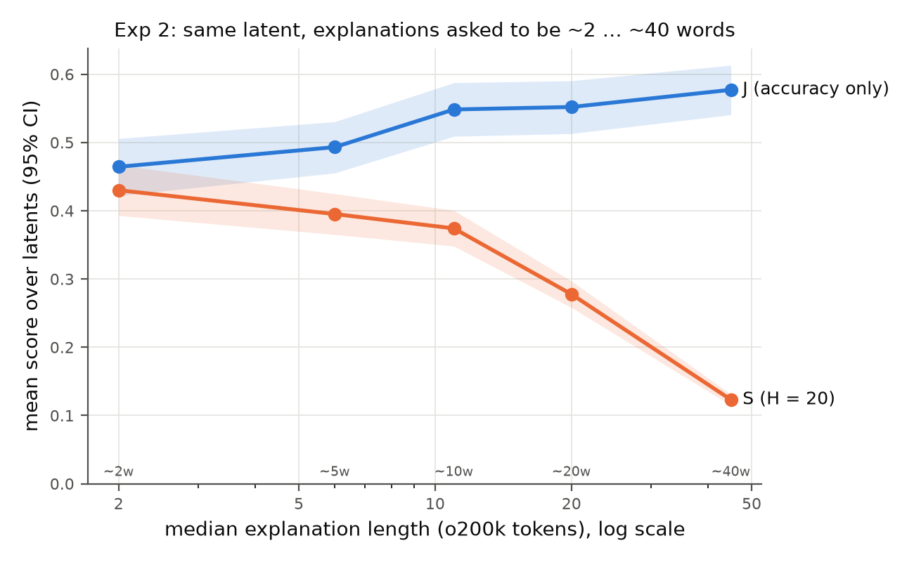
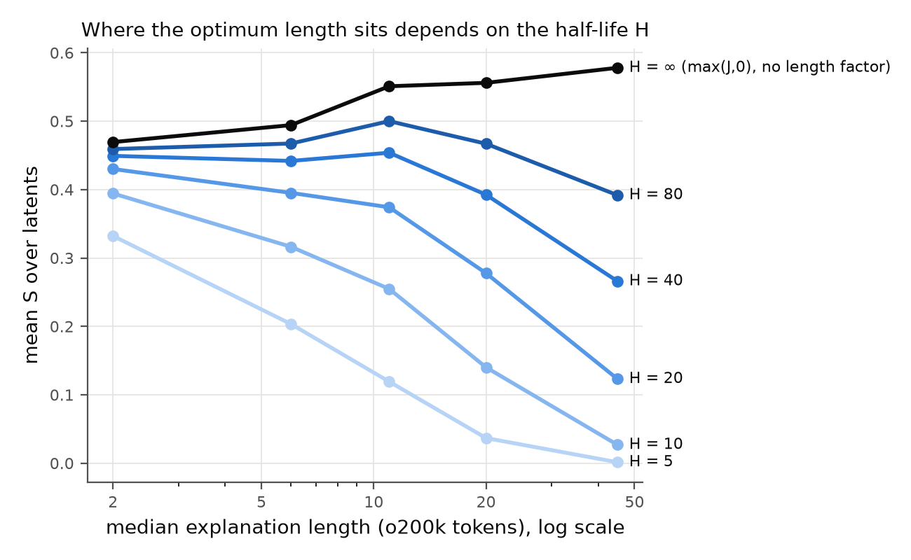
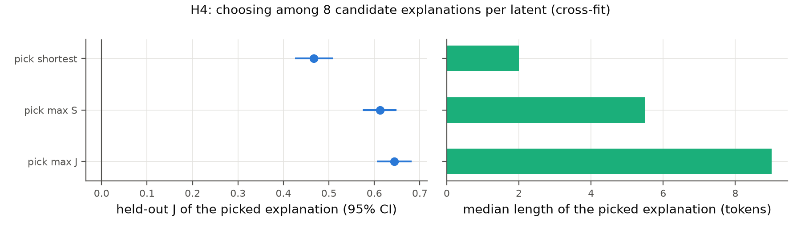

<!-- Generated: concatenation of every experiment report (single source: templates/reports/*.md). -->

# Experiment 0: pilot run and verified negatives

<!-- Generated from templates/reports/exp0_pilot_and_negatives.md; numbers come from results/*/numbers.json. -->

**Goal.** Debug the pipeline end-to-end on 10 latents before the pre-registered main run. Pilot results are never used for confirmatory claims (PREREG section 3).

## Setup

- 10 eligible latents disjoint from the main sample (seed 1).
- The full pipeline: Exp 2 explanations (6 per latent) followed by detection scoring of every condition.
- Scorer and explainer: Llama-3.1-70B-Instruct via OpenRouter, pinned to DeepInfra.

## What the pilot checked, and what it found

| Check | Result |
|---|---|
| Prompts and responses logged in full | Yes (`logs/*_score_pilot.log`; uploaded with the dataset) |
| Scorer answers parse as `[0,1,…]` lists | Failure rate 0.00% of samples in the final pilot |
| Explainer follows the word budgets | Median tokens ~2 words: 3, ~10 words: 12, ~40 words: 46.5 |
| API cost of both pilot runs | US$0.64 for 2060 calls, summed over the discarded first run and the final run (both logged as `*_score_pilot.log`) |
| **Negatives are diverse** | **No.** Neuronpedia's zero-activation rows are sliding windows over a few documents (see below) |

## Issue found: Neuronpedia's zero-activation rows are not random negatives

Reading the logged scorer prompts showed the same sentence again and again among the non-activating examples, each time shifted by one token ("…pretrial conference in Jefferson County District Court next week…"). Across the 210 sampled latents (main + pilot), the export's 5250 zero-activation rows contain only 2010 distinct texts. Within a latent, the rows are overlapping windows of a few documents, and the same documents recur across latents.

Detection scoring measures precision only through its negatives. With nearly duplicate negatives, broad explanations would be penalized too little, and broad explanations are the very ones a length factor interacts with.

**Fix (PREREG deviation 2, recorded before any main results).** We switched to verified random negatives, as in delphi's default (`non_activating_source = "random"`) and in Paulo et al. (App. D.4):

1. GPT-2 small and the *same* SAE (sae_lens `gpt2-small-res-jb`, `blocks.6.hook_resid_pre`) run on 4000 random windows from Skylion007/openwebtext. Each window is one per document, 64 tokens of context, of which the last 17 are shown.
2. A window counts as a negative for a latent if the latent's activation is exactly 0 at all 17 displayed tokens. Each latent had at least 2674 such windows (median 3966), and 25 are sampled per latent.

**Validation of this setup:**

- **Token format.** 100% of Neuronpedia's token strings map back to GPT-2 token ids when the format is assumed to be raw byte-level BPE with `Ġ` shown as a space. So negatives are rendered in exactly the format of the positives, and the scorer cannot tell them apart by formatting.
- **Same SAE.** Re-running 152 of Neuronpedia's top activating windows through our model+SAE (BOS + 17 tokens; the export lacks the longer original context) reproduces the exported maximum activations with Pearson r = 0.988. The maximum falls on the same token in 99.3% of windows, and the latent is active in 100% of them.

With verified negatives, the final pilot's random control scored J = -0.024, about chance. The first pilot run (with Neuronpedia's zero rows) is kept, unused, in `results/pilot_discarded_old_negatives/`.

## Other issues fixed during setup (learnings)

| Issue | Cause | Fix and why |
|---|---|---|
| `delphi` would not install on Windows | It hard-depends on `vllm>=0.10.2`, which has [no native Windows support](https://docs.vllm.ai/en/latest/getting_started/installation/gpu.html), and `delphi/clients/__init__.py` imports `offline.py`, which imports vLLM at module level | Run under WSL2 Ubuntu. Not vendoring delphi's code keeps the base method exactly as published. |
| Every Python start took minutes | The venv was on `/mnt/c`, and WSL reads the Windows drive over the slow 9p protocol; torch and vLLM are thousands of files | Keep the venv on ext4 (`UV_PROJECT_ENVIRONMENT=~/.venvs/concise-interp`); the project stays on the Windows drive. |
| delphi 0.1.3 on PyPI misreports failures | `compute_confusion` returns `failed_count = len(df_valid) - total` (always 0); its explanation parser grabs everything after the first `[EXPLANATION]:` | Pinned delphi to GitHub main commit `4fea06e`, which fixes both. |
| `delphi.log.result_analysis` import error | It imports plotly at module level (the `visualize` extra) | Depend on `eai-delphi[visualize]`. |
| Download phase crashed | `activations/v2/` holds the same rows in a sparse format with different keys | Use top-level batches only. |
| Exp 2 "at most B words" would collapse | delphi's explainer prompt already says "Keep your explanations short and concise" | Changed to "approximately B words" before any results (PREREG deviation 1). The analysis uses the actual length. |
| tiktoken raised on some explanations | An explanation can quote the literal `<\|endoftext\|>`, which tiktoken treats as a disallowed special token | `encode(..., disallowed_special=())` counts it as text. |
| Python crash message at exit of the negatives phase | Hugging Face streaming threads during interpreter shutdown | Harmless: it happens after the output file is written; noted. |

---

# Experiment 1: existing Neuronpedia explanations, a baseline and a control

<!-- Generated from templates/reports/exp1_existing_explanations.md; numbers come from results/main/numbers.json. -->

**Question.** How do existing explanations score under plain detection scoring (J) and under the length-penalized score (S)? Does the scorer behave sensibly: chance for unrelated explanations, above chance for real ones?

## Setup

- **Latents:** 200 latents of `gpt2-small/6-res-jb`, sampled at random (seed 0) from the 17226 eligible ones: those with explanations from both gpt-3.5-turbo and gpt-4o-mini, ≥ 45 activating contexts and ≥ 25 zero-activation rows in the export.
- **Conditions per latent:**
  - `gpt35` and `gpt4omini`: Neuronpedia's explanations, made with OpenAI's token–activation-pair explainer method.
  - `top_token` (baseline): `the token "X"`, with X the most frequent peak token among the 20 strongest contexts.
  - `random` (control): another sampled latent's gpt-4o-mini explanation, via a derangement.
  - Human explanations where Neuronpedia has them. Only 2 exist in the sample, so they are descriptive only.
- **Scoring:** delphi `DetectionScorer`, Llama-3.1-70B-Instruct, 25 activating + 25 verified-negative contexts in shuffled batches of 5. All conditions of a latent see the same batches.

## Results

| explanation source | role | n | mean BA | mean J [95% CI] | median tokens | mean S (H=20) [95% CI] |
|---|---|---:|---:|---:|---:|---:|
| random-explanation control | control | 200 | 0.489 | -0.022 [-0.038, -0.006] | 8 | 0.021 [0.015, 0.029] |
| top-token baseline | baseline | 200 | 0.715 | 0.430 [0.382, 0.477] | 5 | 0.365 [0.326, 0.404] |
| gpt-3.5-turbo (Neuronpedia) | existing | 200 | 0.722 | 0.444 [0.400, 0.490] | 8 | 0.341 [0.307, 0.377] |
| gpt-4o-mini (Neuronpedia) | existing | 200 | 0.750 | 0.499 [0.453, 0.547] | 8 | 0.374 [0.339, 0.408] |
| Llama-3.1-70B, ~2 words | Exp 2 | 200 | 0.732 | 0.464 [0.423, 0.506] | 2 | 0.430 [0.393, 0.467] |
| Llama-3.1-70B, ~5 words | Exp 2 | 200 | 0.747 | 0.493 [0.455, 0.530] | 6 | 0.395 [0.365, 0.424] |
| Llama-3.1-70B, ~10 words | Exp 2 | 200 | 0.774 | 0.548 [0.508, 0.587] | 11 | 0.374 [0.347, 0.400] |
| Llama-3.1-70B, ~20 words | Exp 2 | 200 | 0.776 | 0.552 [0.512, 0.591] | 20 | 0.278 [0.258, 0.297] |
| Llama-3.1-70B, ~40 words | Exp 2 | 200 | 0.789 | 0.577 [0.540, 0.613] | 45 | 0.123 [0.115, 0.131] |
| Llama-3.1-70B, delphi default prompt | Exp 2 | 200 | 0.781 | 0.563 [0.524, 0.601] | 30 | 0.204 [0.189, 0.220] |

(The table also lists the Exp 2 conditions for comparison.)

**H1 (validity of the base scorer): True.**

- The random control scores J = -0.022 [-0.038, -0.006]. That is within the pre-registered |mean| < 0.05, but its CI lies just below 0: unrelated explanations make the scorer flag negatives slightly more often than positives.
- Neuronpedia explanations score well above chance: gpt-3.5-turbo J = 0.444 [0.400, 0.490], gpt-4o-mini J = 0.499 [0.453, 0.547].

**Exploratory: gpt-4o-mini vs gpt-3.5-turbo.**

- gpt-4o-mini's explanations are nominally more accurate, by J = +0.055 [+0.014, +0.096]. The bootstrap CI excludes 0, but the two-sided Wilcoxon test does not reach 0.05 (p = 0.065).
- Both have the same median length (8 vs 8 tokens), and the length factor does not reverse the order: ΔS = +0.033 [+0.004, +0.062] (two-sided Wilcoxon p = 0.175).
- The pre-registered exploratory question was whether they swap rank. They don't.

**The top-token baseline (post hoc comparisons).** `the token "X"` reaches J = 0.430 in a median of 5 tokens. Paired over latents, that is not distinguishable from gpt-3.5-turbo's J (0.444; difference -0.015 [-0.064, +0.036]) and below gpt-4o-mini's (0.499; -0.070 [-0.110, -0.028]). This suggests that many layer-6 GPT-2 latents fire mainly on one token; we did not test that directly.

Under S, the baseline (0.365) is not distinguishable from gpt-3.5-turbo (0.341; +0.023 [-0.016, +0.064]) or gpt-4o-mini (0.374; -0.009 [-0.041, +0.023]). A length-aware score should credit a single-token label when that is all the latent does. The flip side is that the score gives LLM explainers no extra credit for nuance that the detection test cannot measure.

**Human explanations (descriptive only, n = 2).**

- Latent 10398, "periods after sentence fragments": J = 0.36, 5 tokens.
- Latent 10398, "Period at the end of extremely short sentences.": J = 0.60, 9 tokens.

## Interpretation and limitations

- The base scorer passes its sanity check: J separates real explanations from unrelated ones.
- Neuronpedia's explainers saw the top activations. Holding out the 20 strongest contexts reduces but cannot rule out overlap with our test positives. The Exp 2 explanations are fully held out.
- 50 test contexts per explanation make single-explanation J noisy, so the conclusions rest on means over 200 latents.

---

# Experiment 2: does the length factor reward accurate *and* short explanations?

<!-- Generated from templates/reports/exp2_length_budgets.md; numbers come from results/main/numbers.json. -->

**Question.** Hold the latent fixed and vary mainly the requested length of the explanation. Does accuracy rise with length (H2)? Does S peak at an intermediate length at the pre-registered H = 20 (H3, primary)? Does choosing explanations by S, instead of by plain J, give much shorter explanations at a small cost in accuracy (H4)?

## Setup

- **Explainer:** Llama-3.1-70B-Instruct (OpenRouter, DeepInfra, temperature 0) with delphi's `DefaultExplainer` prompt: its system prompt, 3 few-shot examples, and the latent's 20 strongest contexts with `<<highlighted>>` tokens and activation values.
- **Budgets:** one sentence was appended: "Your final explanation (the [EXPLANATION]: line) must be approximately B words long", for B ∈ {2, 5, 10, 20, 40}. One unconstrained explanation used delphi's prompt unchanged.
- **Volume:** 1200 explanations (6 per latent × 200 latents), of which 1200 parsed.
- **Test set:** the test contexts are disjoint from the 20 the explainer saw, so these explanations are fully held out.
- **Budget choice:** pre-registered (PREREG section 5), spaced roughly geometrically from 2 to 40 words. The observed medians run from 2 to 45 tokens, which brackets Neuronpedia's explanations (median 8 tokens) and delphi's unconstrained output (median 30 tokens).

**Manipulation check (median tokens):**

| ~2 words | ~5 | ~10 | ~20 | ~40 | unconstrained |
|---:|---:|---:|---:|---:|---:|
| 2 | 6 | 11 | 20 | 45 | 30 |

The median length rises with every budget step, so the explainer followed the budgets roughly. (For scale: across all 2002 scored explanations there are 0.77 words per o200k token.)

## H2: accuracy rises with length, with diminishing returns (True)

| | ~2 words | ~5 | ~10 | ~20 | ~40 | unconstrained |
|---|---:|---:|---:|---:|---:|---:|
| mean J | 0.464 | 0.493 | 0.548 | 0.552 | 0.577 | 0.563 |

- J(~40) − J(~2) = +0.113 [+0.079, +0.147], Wilcoxon p = 7.1e-09.
- The J gain per nominal word from 2→10 words, minus the gain per word from 10→40, is +0.0095 [+0.0056, +0.0136] > 0. That is diminishing returns.
- Across all 2002 scored explanations, J and length are only weakly related (Spearman 0.13).

## H3 (primary): an interior optimum at H = 20? **False — falsified**

| | ~2 words | ~5 | ~10 | ~20 | ~40 | unconstrained |
|---|---:|---:|---:|---:|---:|---:|
| mean S (H=20) | 0.430 | 0.395 | 0.374 | 0.278 | 0.123 | 0.204 |

| comparison (S at H=20) | mean difference [95% CI] | Wilcoxon p (one-sided) | Holm p |
|---|---:|---:|---:|
| ~5 words − ~2 words | -0.035 [-0.064, -0.006] | 0.99 | 1 |
| ~5 words − ~40 words | +0.272 [+0.246, +0.297] | 6.6e-33 | 3.3e-32 |
| ~10 words − ~2 words | -0.056 [-0.081, -0.031] | 1 | 1 |
| ~10 words − ~40 words | +0.251 [+0.230, +0.271] | 1.9e-33 | 1.1e-32 |
| ~20 words − ~2 words | -0.152 [-0.181, -0.123] | 1 | 1 |
| ~20 words − ~40 words | +0.155 [+0.141, +0.169] | 6.8e-33 | 3.3e-32 |

Every intermediate budget beats ~40 words, but none beats ~2 words. On average, the accuracy gained by writing more is smaller than the length cost at H = 20.

From ~2 to ~10 words, mean J rises by a factor of 1.18. Over the same stretch, the length factor at the median lengths (2 → 11 tokens) falls by a factor of 0.73. The pre-registered prediction is therefore falsified.

### Exploratory (post hoc): the H sweep

| H (tokens) | random-explanation control | top-token baseline | gpt-3.5-turbo (Neuronpedia) | gpt-4o-mini (Neuronpedia) | Llama-3.1-70B, ~2 words | Llama-3.1-70B, ~5 words | Llama-3.1-70B, ~10 words | Llama-3.1-70B, ~20 words | Llama-3.1-70B, ~40 words | Llama-3.1-70B, delphi default prompt | best budget |
|---|---:|---:|---:|---:|---:|---:|---:|---:|---:|---:|---|
| 5 | 0.009 | 0.216 | 0.161 | 0.163 | 0.332 | 0.203 | 0.119 | 0.037 | 0.001 | 0.014 | ~2 words |
| 10 | 0.016 | 0.306 | 0.262 | 0.280 | 0.394 | 0.316 | 0.255 | 0.140 | 0.027 | 0.079 | ~2 words |
| 20 | 0.021 | 0.365 | 0.341 | 0.374 | 0.430 | 0.395 | 0.374 | 0.278 | 0.123 | 0.204 | ~2 words |
| 40 | 0.025 | 0.398 | 0.391 | 0.434 | 0.449 | 0.442 | 0.454 | 0.392 | 0.266 | 0.337 | ~10 words |
| 80 | 0.027 | 0.416 | 0.419 | 0.468 | 0.459 | 0.467 | 0.500 | 0.467 | 0.392 | 0.435 | ~10 words |
| ∞ (no length factor: max(J, 0)) | 0.029 | 0.435 | 0.450 | 0.505 | 0.469 | 0.494 | 0.551 | 0.556 | 0.578 | 0.565 | ~40 words |

At H = 40 the budget with the highest mean S is ~10 words:

- vs ~2 words: +0.005 [-0.022, +0.032], one-sided Wilcoxon p = 0.80 (a tie);
- vs ~40 words: +0.188 [+0.167, +0.208], p = 6.1e-29.

At H = 80 it is ~10 words:

- vs ~2 words: +0.041 [+0.013, +0.069], p = 0.050 (the bootstrap CI excludes 0, the Wilcoxon test is borderline);
- vs ~40 words: +0.108 [+0.087, +0.128], p = 4.8e-18.

These comparisons were chosen after seeing the data and are not corrected for multiplicity, so they are hypotheses for a future pre-registered test, not confirmed findings.

## H4: choosing explanations by S (True)

- **Candidates:** for each latent, the 6 Exp 2 explanations plus Neuronpedia's gpt-3.5-turbo and gpt-4o-mini explanations.
- **Cross-fitting:** the test contexts are split into halves, stratified by class. We choose on one half, measure J on the other, then swap. This avoids rewarding explanations that won by noise (the winner's curse).

| selection rule | held-out mean J [95% CI] | median tokens |
|---|---:|---:|
| pick highest J (plain detection) | 0.644 [0.605, 0.682] | 9.0 |
| pick highest S (this method) | 0.613 [0.574, 0.649] | 5.5 |
| pick shortest | 0.467 [0.425, 0.509] | 2.0 |

- **Length:** argmax-S picks are 39% shorter than argmax-J picks (criterion: ≥ 20%).
- **Accuracy loss:** J drops by 0.031 [0.018, 0.046] (criterion: ≤ 0.05).
- **Versus shortest:** argmax-S beats argmin-L by 0.146 [0.115, 0.179] J (criterion: CI > 0).

All three pre-registered criteria hold. Which candidates got picked (counts over 400 selections: 2 halves × 200 latents):

- argmax J: ~2 words 80, ~5 51, ~10 43, ~20 32, ~40 28, unconstrained 29, gpt-3.5 63, gpt-4o-mini 74.
- argmax S: ~2 words 145, ~5 78, ~10 27, ~20 8, ~40 2, unconstrained 1, gpt-3.5 67, gpt-4o-mini 72.

Plain J often picks short explanations too, likely because ties are broken toward the shorter one and J is noisy on 25 contexts (we did not measure how often ties occur). Even so, S moves picks away from the long budgets almost completely.

## Takeaways

1. The length factor does what it is designed to do at the level of choosing an explanation per latent: much shorter picks for little accuracy (H4).
2. Averaged over latents, the pre-registered H = 20 is too harsh to make anything but the shortest budget optimal (H3 falsified). H is a value judgement. In the post-hoc sweep, ~10 words ties ~2 words at H = 40 and is nominally ahead at H = 80 (one-sided p = 0.050).
3. For these GPT-2 layer-6 latents, a ~2-word explanation from a strong explainer already reaches most of the J of a ~40-word one: 0.464 vs 0.577.

---

# Reliability: re-scoring with a new shuffle seed and with a different scorer

<!-- Generated from templates/reports/reliability.md; numbers come from results/main/numbers.json. -->

**Question.** How much do the scores depend on noise in the scorer LLM, and on which LLM is the scorer?

## Setup

- A random 50-latent subset of the main sample (seed 2), with all Exp 1 and Exp 2 conditions. The explanations and test contexts are identical to the main run.
- **Retest:** same scorer (Llama-3.1-70B, DeepInfra), delphi shuffle seed 43 instead of 42. This changes which 5 contexts share a prompt and their order.
- **Alternative scorer:** Llama-3.3-70B-Instruct (OpenRouter default routing), seed 42. Unlike the pinned main scorer, its calls were served by several providers, which may differ in quantization (table below).
- Cost of both re-scorings: US$2.03 for 10040 calls.

Providers that served each run, counted from the logs:

| phase | output | provider: calls |
|---|---|---|
| score | `explain` | DeepInfra: 1200 |
| score | `scores` | DeepInfra: 20020 |
| reliability | `scores_retest` | DeepInfra: 5020 |
| reliability | `scores_altscorer` | AkashML: 4056, Parasail: 907, DeepInfra: 48, Novita: 4, SambaNova: 3, Groq: 2 |

## Results

| re-scoring | latents | explanations | Spearman J | Spearman S |
|---|---:|---:|---:|---:|
| same scorer, new shuffle seed (43) | 50 | 502 | 0.961 | 0.957 |
| Llama-3.3-70B as scorer | 50 | 502 | 0.971 | 0.968 |

Spearman correlations are computed over individual explanations, each scored on only 50 contexts, so they include sampling noise from the scorer's per-batch answers.

**Does H3's direction hold under the re-scorings?** Mean S (H = 20) per budget on the 50-latent subset:

| scoring | ~2 words | ~5 | ~10 | ~20 | ~40 |
|---|---:|---:|---:|---:|---:|
| main run (Llama-3.1-70B, seed 42) | 0.409 | 0.353 | 0.336 | 0.239 | 0.105 |
| retest (Llama-3.1-70B, seed 43) | 0.423 | 0.357 | 0.344 | 0.245 | 0.107 |
| Llama-3.3-70B as scorer (seed 42) | 0.424 | 0.338 | 0.352 | 0.250 | 0.108 |

## Interpretation

Per-explanation J and S rankings are highly reproducible: Spearman ≥ 0.957, both under a new batch shuffle and with a different scorer model.

Under both re-scorings, the ~2-word budget keeps the highest mean S, so the H3 conclusion (no interior optimum at H = 20) holds for one other shuffle seed and one other scorer on these 50 latents. These subset means are descriptive; no test was run on them. With Llama-3.3-70B, ~10 words scores slightly above ~5 words; both remain below ~2 words.

