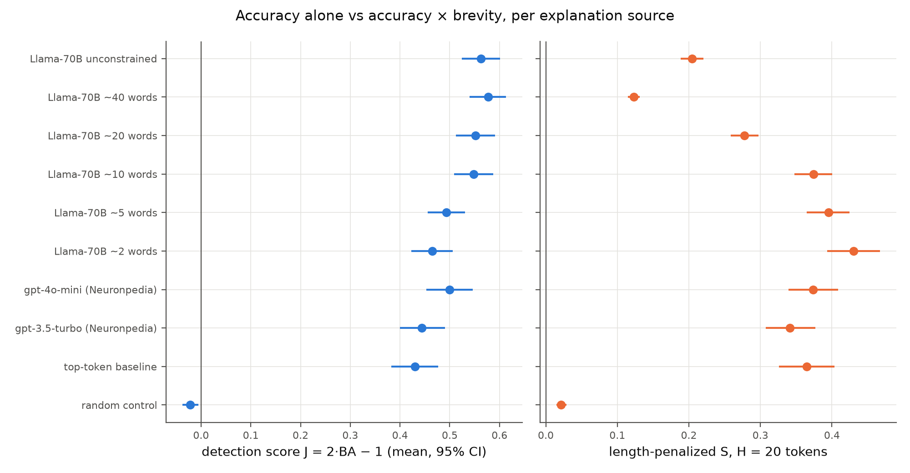

# Experiment 1: existing Neuronpedia explanations, a baseline and a control

<!-- Generated from templates/reports/exp1_existing_explanations.md; numbers come from results/main/numbers.json. -->

**Question.** How do existing explanations score under plain detection scoring (J) and under the length-penalized score (S)? Does the scorer behave sensibly: chance for unrelated explanations, above chance for real ones?

## Setup

- **Latents:** 200 latents of `gpt2-small/6-res-jb`, sampled at random (seed 0) from the 17226 eligible ones: those with explanations from both gpt-3.5-turbo and gpt-4o-mini, ≥ 45 activating contexts and ≥ 25 zero-activation rows in the export.
- **Conditions per latent:**
  - `gpt35` and `gpt4omini`: Neuronpedia's explanations, made with OpenAI's token–activation-pair explainer method.
  - `top_token` (baseline): `the token "X"`, with X the most frequent peak token among the 20 strongest contexts.
  - `random` (control): another sampled latent's gpt-4o-mini explanation, via a derangement.
  - Human explanations where Neuronpedia has them. Only 2 exist in the sample, so they are descriptive only.
- **Scoring:** delphi `DetectionScorer`, Llama-3.1-70B-Instruct, 25 activating + 25 verified-negative contexts in shuffled batches of 5. All conditions of a latent see the same batches.

## Results

| explanation source | role | n | mean BA | mean J [95% CI] | median tokens | mean S (H=20) [95% CI] |
|---|---|---:|---:|---:|---:|---:|
| random-explanation control | control | 200 | 0.489 | -0.022 [-0.038, -0.006] | 8 | 0.021 [0.015, 0.029] |
| top-token baseline | baseline | 200 | 0.715 | 0.430 [0.382, 0.477] | 5 | 0.365 [0.326, 0.404] |
| gpt-3.5-turbo (Neuronpedia) | existing | 200 | 0.722 | 0.444 [0.400, 0.490] | 8 | 0.341 [0.307, 0.377] |
| gpt-4o-mini (Neuronpedia) | existing | 200 | 0.750 | 0.499 [0.453, 0.547] | 8 | 0.374 [0.339, 0.408] |
| Llama-3.1-70B, ~2 words | Exp 2 | 200 | 0.732 | 0.464 [0.423, 0.506] | 2 | 0.430 [0.393, 0.467] |
| Llama-3.1-70B, ~5 words | Exp 2 | 200 | 0.747 | 0.493 [0.455, 0.530] | 6 | 0.395 [0.365, 0.424] |
| Llama-3.1-70B, ~10 words | Exp 2 | 200 | 0.774 | 0.548 [0.508, 0.587] | 11 | 0.374 [0.347, 0.400] |
| Llama-3.1-70B, ~20 words | Exp 2 | 200 | 0.776 | 0.552 [0.512, 0.591] | 20 | 0.278 [0.258, 0.297] |
| Llama-3.1-70B, ~40 words | Exp 2 | 200 | 0.789 | 0.577 [0.540, 0.613] | 45 | 0.123 [0.115, 0.131] |
| Llama-3.1-70B, delphi default prompt | Exp 2 | 200 | 0.781 | 0.563 [0.524, 0.601] | 30 | 0.204 [0.189, 0.220] |

(The table also lists the Exp 2 conditions for comparison.)

**H1 (validity of the base scorer): True.**

- The random control scores J = -0.022 [-0.038, -0.006]. That is within the pre-registered |mean| < 0.05, but its CI lies just below 0: unrelated explanations make the scorer flag negatives slightly more often than positives.
- Neuronpedia explanations score well above chance: gpt-3.5-turbo J = 0.444 [0.400, 0.490], gpt-4o-mini J = 0.499 [0.453, 0.547].

**Exploratory: gpt-4o-mini vs gpt-3.5-turbo.**

- gpt-4o-mini's explanations are nominally more accurate, by J = +0.055 [+0.014, +0.096]. The bootstrap CI excludes 0, but the two-sided Wilcoxon test does not reach 0.05 (p = 0.065).
- Both have the same median length (8 vs 8 tokens), and the length factor does not reverse the order: ΔS = +0.033 [+0.004, +0.062] (two-sided Wilcoxon p = 0.175).
- The pre-registered exploratory question was whether they swap rank. They don't.

**The top-token baseline (post hoc comparisons).** `the token "X"` reaches J = 0.430 in a median of 5 tokens. Paired over latents, that is not distinguishable from gpt-3.5-turbo's J (0.444; difference -0.015 [-0.064, +0.036]) and below gpt-4o-mini's (0.499; -0.070 [-0.110, -0.028]). This suggests that many layer-6 GPT-2 latents fire mainly on one token; we did not test that directly.

Under S, the baseline (0.365) is not distinguishable from gpt-3.5-turbo (0.341; +0.023 [-0.016, +0.064]) or gpt-4o-mini (0.374; -0.009 [-0.041, +0.023]). A length-aware score should credit a single-token label when that is all the latent does. The flip side is that the score gives LLM explainers no extra credit for nuance that the detection test cannot measure.

**Human explanations (descriptive only, n = 2).**

- Latent 10398, "periods after sentence fragments": J = 0.36, 5 tokens.
- Latent 10398, "Period at the end of extremely short sentences.": J = 0.60, 9 tokens.

## Interpretation and limitations

- The base scorer passes its sanity check: J separates real explanations from unrelated ones.
- Neuronpedia's explainers saw the top activations. Holding out the 20 strongest contexts reduces but cannot rule out overlap with our test positives. The Exp 2 explanations are fully held out.
- 50 test contexts per explanation make single-explanation J noisy, so the conclusions rest on means over 200 latents.
