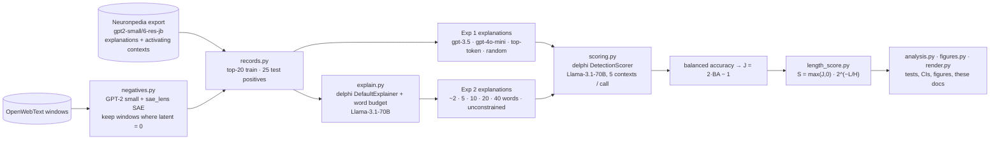

## How it works



### What happens when you run it

1. **`download`** lists and downloads Neuronpedia's public export for `gpt2-small/6-res-jb` (73 gzipped JSONL batches, about 200 MB, into `data/raw/`). It then checks which latents are eligible and draws the pre-registered samples (main 200, pilot 10, reliability 50) into `data/processed/`.
2. **`negatives`** loads GPT-2 small and the exact same SAE through `sae_lens`. It first checks that it reproduces Neuronpedia's exported activations. It then streams 4,000 random OpenWebText windows and records, for every sampled latent, the windows on which it is exactly 0.
3. **`score`** has two parts:
   - **Exp 2:** Llama-3.1-70B writes explanations at each word budget, using delphi's explainer prompt and the 20 strongest contexts.
   - **Exp 1 + Exp 2:** delphi's `DetectionScorer` asks Llama-3.1-70B, 5 contexts at a time, which contexts match each explanation.

   Every prompt and response goes, untruncated, to `logs/<timestamp>_<phase>.log` and to the terminal. Every per-context prediction goes to `results/<sample>/scores.jsonl`. Re-running skips finished jobs.
4. **`reliability`** re-scores 50 latents with a new shuffle seed, and again with Llama-3.3-70B as the scorer.
5. **`analyze`** recomputes balanced accuracy with delphi's own metric code, then derives J, L and S. It runs the pre-registered tests and writes `results/main/numbers.json`, `figures/*.png` and `docs/data.json`, and renders this README, `reports/` and `paper/` from `templates/`.

## Install and run

You need Linux, or WSL2 on Windows (delphi depends on vLLM, which only installs on Linux), [uv](https://docs.astral.sh/uv/), an NVIDIA GPU for the `negatives` phase (GPT-2 small; 8 GB is plenty), and an [OpenRouter](https://openrouter.ai) API key.

```bash
git clone https://github.com/BurnyCoder/accurate-and-simple-mechanistic-interpretability-explanations
cd accurate-and-simple-mechanistic-interpretability-explanations
cp .env.example .env   # then put your OPENROUTER_API_KEY in .env
```

On WSL2 with the repo on the Windows drive (`/mnt/c/...`), keep the virtual environment on the Linux filesystem. Importing torch and vLLM over `/mnt/c` takes minutes:

```bash
export UV_PROJECT_ENVIRONMENT=$HOME/.venvs/concise-interp
```

```bash
uv sync
uv run pytest -q
uv run python run.py --phase download
uv run python run.py --phase negatives
uv run python run.py --phase score --sample pilot
uv run python run.py --phase score --sample main
uv run python run.py --phase reliability
uv run python run.py --phase analyze --sample main
```

`analyze` alone regenerates every table, figure and number in this README and the paper from the committed `results/` files, with no API calls. The processed data (`data/processed/`) and all results are committed, so the analysis reproduces without re-downloading or re-scoring.

## Repository layout

| Path | What it is |
|---|---|
| `run.py` | Entry point; runs the phases in order. |
| `src/concise_interp/length_score.py` | **The method:** J, L, the length factor, S. |
| `src/concise_interp/{data,negatives,records,baselines,experiment}.py` | Data, verified negatives, delphi records, baselines and controls, jobs. |
| `src/concise_interp/{clients,scoring,explain}.py` | delphi's OpenRouter client (with logging), DetectionScorer, DefaultExplainer with a word budget. |
| `src/concise_interp/{analysis,figures,render}.py` | Statistics, figures, docs rendered from results. |
| `tests/` | pytest suite. |
| `PREREG.md` | Pre-registration (committed before any results) and its deviations. |
| `templates/` | Sources of this README, `reports/` and `paper/`. Every number is a placeholder filled from `results/main/numbers.json`. |
| `results/` | All scored explanations with per-context predictions. `pilot_discarded_old_negatives/` is the discarded first pilot. |
| `figures/`, `reports/`, `paper/`, `docs/` | Figures, experiment reports, paper (Markdown + PDF), GitHub Pages explorer + methodology. |

## Technologies

- [delphi](https://github.com/EleutherAI/delphi), pinned to commit `4fea06e`: detection scorer, explainer, OpenRouter client, metrics.
- [sae_lens](https://github.com/jbloomAus/SAELens) and [TransformerLens](https://github.com/TransformerLensOrg/TransformerLens): GPT-2 small and the SAE.
- [OpenRouter](https://openrouter.ai): Llama-3.1-70B-Instruct, pinned to the DeepInfra provider, with Llama-3.3-70B as the alternative scorer.
- [tiktoken](https://github.com/openai/tiktoken) (`o200k_base`) for lengths.
- [Neuronpedia](https://www.neuronpedia.org) exports and [OpenWebText](https://huggingface.co/datasets/Skylion007/openwebtext) for data.
- pandas, SciPy, matplotlib for analysis; pytest for tests; uv for the environment.
